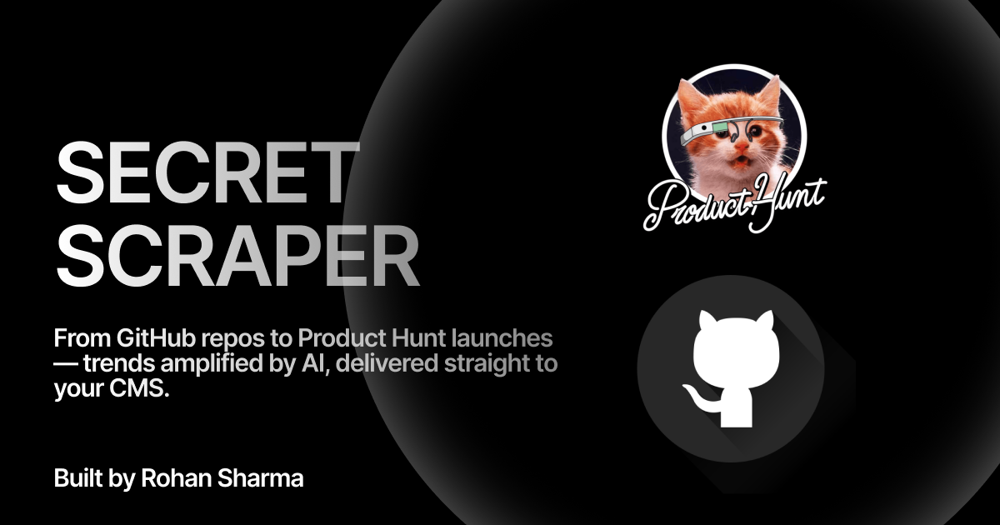

# Secret Scrapper

> **100% Open Source · Zero Telemetry · Your Data Never Leaves Your Browser**

Secret Scrapper is a privacy-first platform for discovering and curating trending products from **GitHub** and **ProductHunt**. Scrape leaderboards, deep-dive into individual products, enhance data with AI, and export — all from your browser with zero data collection.

---

## 🔒 Privacy & Security

Secret Scrapper is built on a **zero-trust, privacy-first** foundation:

- **No API keys are stored on any server.** All API keys (Firecrawl, OpenAI, Groq, Gemini) are stored exclusively in your browser's `localStorage`. They are sent directly from your browser to the respective API providers — we never see, log, or store them.
- **No telemetry.** We collect absolutely zero analytics, usage data, or tracking information.
- **No cloud storage.** All scraped products are stored in your browser's `IndexedDB`. Your data stays on your machine until you explicitly export it.
- **No accounts required.** There is no sign-up, login, or user tracking of any kind.
- **Fully open source.** The entire codebase is MIT-licensed and available for inspection. What you see is what runs.

---

## ✨ Features

### Scraping
- **GitHub Trending**: Discover trending repositories from GitHub (daily, weekly, monthly) with star counts, descriptions, languages, and topics.
- **ProductHunt Leaderboard**: Scrape ProductHunt leaderboards (daily, weekly, monthly) using [Firecrawl](https://www.firecrawl.dev). Choose **Featured**, **All**, or **Both** scope.
- **Deep Scrape**: Deep-dive into individual ProductHunt products to extract full descriptions, GitHub repository links, social media handles (X/Twitter, etc.), and official website URLs.
- **Tags Extraction**: Automatically extracts topic/category tags from ProductHunt products.

### AI Enhancement
- **Multi-Provider Support**: Enhance product data with **OpenAI** (GPT-4o, GPT-4o-mini), **Groq** (Llama, Mixtral), or **Google Gemini** (Gemini 2.0 Flash).
- **Bulk Enhancement**: Enhance multiple products at once — AI-generated summaries, highlights, feature lists, and domain classification.
- **Language Detection**: Automatically detects and translates non-English descriptions.

### Product Management
- **Full Editor**: Edit descriptions, features, tags, social links, and metadata per product.
- **Approve/Reject Workflow**: Curate products with status management.
- **Multi-Select**: Select multiple products for bulk deep scrape, export, or delete.
- **Filters**: Filter by source, domain, status, category, and tags.

### Export
- **JSON Export**: Export your curated product data as JSON.

---

## 🏗️ Architecture

Secret Scrapper is a **single-stack Next.js application** — no separate backend, no external databases.

| Layer | Technology |
|-------|-----------|
| **Framework** | Next.js 15 (App Router) |
| **Language** | TypeScript |
| **Styling** | Tailwind CSS v4 + shadcn/ui |
| **Runtime** | Bun |
| **Storage** | Browser IndexedDB / localStorage |
| **PH Scraping** | Firecrawl API (`@mendable/firecrawl-js`) |
| **GitHub Scraping** | Direct HTML parsing (JSDOM) |
| **AI Providers** | OpenAI, Groq, Google Gemini |

---

## 🔑 API Keys

All API keys are entered in the browser and stored **only** in your browser's `localStorage`. They are never transmitted to our servers — they go directly to the respective API providers.

| Key | Purpose | Where to Get |
|-----|---------|-------------|
| **Firecrawl** | ProductHunt scraping | [firecrawl.dev](https://www.firecrawl.dev) |
| **OpenAI** | AI enhancement (GPT-4o) | [platform.openai.com](https://platform.openai.com) |
| **Groq** | AI enhancement (Llama/Mixtral) | [console.groq.com](https://console.groq.com) |
| **Gemini** | AI enhancement (Gemini 2.0) | [aistudio.google.com](https://aistudio.google.com) |

---

## 📖 How It Works

### Scraping Products

1. Open the **Scrape Dialog** from the dashboard.
2. Choose your source: **GitHub** or **ProductHunt**.
3. For **ProductHunt**:
   - Enter your Firecrawl API key (stored in your browser only).
   - Select time period: Daily, Weekly, or Monthly.
   - Enter the target date/week/month.
   - Choose scope: **Featured** (curated picks), **All** (every product), or **Both**.
4. Hit **Start Scraping** — products appear in your dashboard instantly.

### Deep Scraping (ProductHunt)

After scraping a leaderboard, deep scrape individual products to extract:
- Full product description
- GitHub repository link
- Social media handles (X/Twitter, etc.)
- Official website URL

Use the **🔍 Deep Scrape** button on any product card, or select multiple and use **Bulk Deep Scrape**.

### AI Enhancement

Feed your scraped products through OpenAI, Groq, or Gemini to generate:
- Concise summaries
- Key feature highlights
- Domain classification (AI, DevOps, Code, etc.)
- Language detection & translation

### Curate & Export

- **Edit** product details, tags, social links, and metadata.
- **Approve/Reject** products for your workflow.
- **Export** your curated dataset as JSON.

---

## �️ Contributing

Secret Scrapper is open source and contributions are welcome!

```bash
# Clone the repo
git clone https://github.com/RS-labhub/secret-scraper.git
cd secret-scraper

# Install dependencies
bun install

# Start the dev server
bun run dev
```

---

## 📜 License

This project is open source under the [MIT License](LICENSE).

---

## Meet the Author


<div align="center">

**Built for Finding Radhika by [RS-labhub](https://github.com/RS-labhub)**
